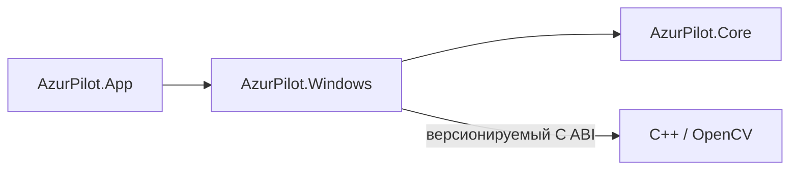

<div align="center">

# AzurPilotRu

**Управление MuMu и окружением Azur Lane Global/EN из Windows.**

[](https://github.com/AliceLiddell01/AzurPilotRu/actions/workflows/ci.yml?query=branch%3Amain)

[](LICENSE)

Операторский TUI · Agent CLI / JSON · .NET / C# · C++ / OpenCV

[Возможности](#возможности) · [Быстрый старт](#быстрый-старт) · [Управление](#управление) · [Архитектура](#архитектура) · [Проверки](#проверки) · [Документация](#документация)

</div>

AzurPilotRu — персональная реализация AzurPilot для Windows x64. Приложение помогает выбрать
конкретный экземпляр MuMu, подготовить Android, запустить или остановить Azur Lane и проверить
результат. Для оператора доступен русскоязычный интерфейс в терминале, для внешних агентов —
отдельные команды с JSON-ответами. Оба интерфейса используют общие прикладные операции.

Реализованы управление окружением, диагностика и базовая игровая возможность: распознавание известных
ассетов, безопасный tap с независимой проверкой эффекта и ограниченный login flow до доказанного
главного UI через Agent CLI. OCR/ONNX и автоматическое прохождение игровых задач пока не реализованы.

## Возможности

| Возможность | Что реализовано |
| --- | --- |
| **Операторский TUI** | Интерактивная оболочка на Terminal.Gui: состояние окружения, запуск и остановка, настройки, помощь и режимы доступа к техническим операциям. |
| **Управление MuMu** | Обнаружение установки и экземпляров поддерживаемого семейства MuMu 6, выбор точного экземпляра, запуск, остановка и перезапуск с проверкой результата. |
| **Android / ADB** | Работа с поставляемым ADB, разрешение адреса выбранного экземпляра, проверка транспорта, shell и завершения загрузки Android. |
| **Жизненный цикл игры** | Наблюдение за установкой, процессом и передним планом Azur Lane Global/EN; запуск и остановка через общий сервис управления. |
| **Agent CLI** | Команды `agent` с обнаружением поддерживаемых операций, JSON-ответами, типизированными отказами и явной адресацией целевого экземпляра. |
| **Диагностика скриншотов** | Получение PNG через Android, декодирование в нативный RGB8-кадр и анализ именованных областей `FullFrame` и `Center` средствами OpenCV. |
| **Игровой UI** | Геометрия landscape 16:9 от 720p до 4K, проверенные ассеты, нативный поиск по ROI; безопасное открытие Dock и подтверждённый возврат через Agent CLI. [Контракт и ограничения](docs/architecture/game-ui.md). |
| **Конфигурация и журнал** | Строгая конфигурация, сохранение настроек из TUI, структурированные журналы и отдельное окно просмотра журнала. |

Точный набор команд и ограничения каждого режима: [операторский TUI](docs/architecture/operator-tui.md) и [Agent CLI](docs/reference/agent-cli.md).

Обычная диагностика читает состояние: она не запускает MuMu или игру и не выполняет ADB connect.
Изменяющие состояние операции требуют однозначно выбранного экземпляра. `auto` разрешается только
при единственном кандидате; первый экземпляр из списка не выбирается автоматически.
Статистика пикселей показывает свойства изображения, но не определяет экран игрового UI.

## Быстрый старт

### Что потребуется

- **Windows x64** — единственная поддерживаемая платформа.
- **.NET SDK** — точная версия и политика выбора в [`global.json`](global.json).
- **Visual Studio 2026** с workload «Desktop development with C++» и x64 MSVC toolset.
- **CMake** и **Git**, доступные из `PATH`. Минимум CMake и MSVC задан в
  [`native/CMakeLists.txt`](native/CMakeLists.txt).
- Сеть при первом получении OpenCV: CMake загружает и проверяет пакет по
  [`native/opencv.json`](native/opencv.json), ручная установка OpenCV не требуется.

Для управления нужны установленная **MuMuPlayer семейства 6** и, для игровых операций,
**Azur Lane Global/EN** в выбранном Android-экземпляре. Приложение не устанавливает эмулятор или игру.
Без MuMu оболочка остаётся доступна и показывает диагностическое состояние.
Совместимость проверяется по ответам `MuMuManager`, а не только по номеру версии:
подробности — в [описании интеграции MuMu](docs/architecture/mumu-lifecycle.md).

### Сборка и запуск

Откройте **PowerShell**:

```powershell
git clone https://github.com/AliceLiddell01/AzurPilotRu.git
cd AzurPilotRu

# Нативная библиотека и её тесты
Push-Location native
cmake --workflow --preset native-x64-release
Pop-Location

# .NET: зависимости, сборка, проверки
dotnet restore AzurPilot.slnx --locked-mode
dotnet build AzurPilot.slnx --configuration Release --no-restore -warnaserror
dotnet test tests/AzurPilot.Tests/AzurPilot.Tests.csproj --configuration Release --no-restore --no-build

# Запуск интерактивного приложения
dotnet run --project src/AzurPilot.App --configuration Release --no-build
```

Переходите к следующему шагу только после успешного завершения предыдущего. Native workflow
подготавливает DLL, необходимые для managed-сборки и interop-тестов.

TUI открывается, когда stdin и stdout подключены к терминалу. Если любой из этих потоков
перенаправлен, приложение выполняет одноразовую диагностику и завершается.

[Полная инструкция по сборке, запуску и устранению ошибок →](docs/getting-started.md)

## Управление

### Первый запуск в TUI

1. Нажмите `/` или `F2`, чтобы открыть палитру, и выберите **«Запустить окружение»**.
2. Проверьте точный ID MuMu в подтверждении. При нескольких экземплярах выберите нужный;
   выбор можно сохранить или использовать только для текущего действия.
3. Дождитесь готовности MuMu и Android. Для запуска Azur Lane выберите **«Запустить игру»**;
   это действие также умеет подготовить окружение самостоятельно.

«Запустить окружение» подготавливает Android без запуска игры. «Остановить игру» и
«Остановить окружение» — отдельные действия; остановка окружения останавливает выбранный MuMu.
`F4` отменяет текущую операцию, но не откатывает уже выполненные действия: MuMu или игра могут
остаться запущенными. Справка доступна через `/help` или пункт «Помощь» в палитре.

Через **«Настройки»** можно сохранить выбранный экземпляр, режим интерфейса и настройку отдельной
лог-консоли. Конфигурация хранится в `%LOCALAPPDATA%\AzurPilot\config.yaml`. При отсутствии файла
используются встроенные значения по умолчанию; существующий невалидный файл вызывает явный отказ.

Режимы интерфейса:

| Режим | Для чего |
| --- | --- |
| `normal` | Основные пользовательские операции, состояние, настройки. |
| `manual` | Дополнительно — ручные действия с MuMu, Android и игрой. |
| `diagnostic` | Дополнительно — подробная диагностика, скриншоты и технические сведения. |

Режим можно выбрать при запуске:

```powershell
dotnet run --project src/AzurPilot.App -c Release --no-build -- --mode diagnostic
```

[Действия и клавиатура TUI](docs/architecture/operator-tui.md) · [Формат конфигурации](docs/reference/application-configuration.md)

### Команды для внешних агентов

Agent CLI не требует запуска интерактивного терминала. Его контракт можно получить из самого приложения:

```powershell
dotnet run --project src/AzurPilot.App -c Release --no-build -- agent discover
dotnet run --project src/AzurPilot.App -c Release --no-build -- agent status
dotnet run --project src/AzurPilot.App -c Release --no-build -- agent instances
```

Для интеграции вызывайте собранный `AzurPilot.App.exe agent …` напрямую: контракт приложения — один
UTF-8 JSON-документ в `stdout`, диагностические сообщения отдельно в `stderr`.
`discover` работает без конфигурации, MuMu и ADB и публикует поддерживаемые команды и аргументы.

Для операций над экземпляром используйте `--target` с ID из `instances`. Вызов команды изменения
состояния в Agent CLI уже является явным запросом: интерактивного подтверждения нет.
Результат сообщает `effect`: `none`, `changed` или `mayHaveChanged`; отказ или отмена не означают,
что состояние осталось прежним.

[Справочник Agent CLI и формат результатов →](docs/reference/agent-cli.md)

## Архитектура

Проект состоит из **трёх .NET-компонентов приложения** и отдельной **нативной библиотеки**:



| Компонент | Ответственность |
| --- | --- |
| [`AzurPilot.Core`](src/AzurPilot.Core) | Доменные контракты, конфигурация и оркестрация жизненного цикла без Windows-адаптеров. |
| [`AzurPilot.Windows`](src/AzurPilot.Windows) | Windows-адаптеры, MuMu, ADB и взаимодействие с нативной библиотекой. |
| [`AzurPilot.App`](src/AzurPilot.App) | Composition root, общие операторские сценарии, TUI, Agent CLI, журнал и диагностика. |
| [`native/`](native/) | CMake, C++20, OpenCV и версионируемый C ABI для нативных операций. |

TUI и Agent CLI обращаются к общим операторским сервисам в `AzurPilot.App`. UI не формирует команды
ADB и не выбирает endpoint самостоятельно. Проекты `tests/**` и `tools/**` служат для проверки
и разработки и не являются продуктовыми компонентами.

[Подробная схема архитектуры и границы компонентов →](docs/architecture/overview.md)

## Проверки

| Уровень | Что проверяется |
| --- | --- |
| **CMake / CTest** | Сборка нативной библиотеки и поведение ABI. |
| **Тесты .NET** | Межъязыковое взаимодействие, конфигурация, сценарии отказа, управление окружением и контракты репозитория. |
| **Windows CI** | Стандартные сборка и автоматические проверки в Windows. |
| **Локальная приёмка** | Поведение на реальном MuMu/ADB/Azur Lane и проверка получения изображений; не заменяется имитациями в CI. |
| **TUI Harness** | Запуск настоящего приложения через ConPTY, воспроизведение терминального вывода и визуальные проверки. |

CI проверяет код и контролируемые сценарии, но **не подтверждает работу на конкретной установленной у пользователя MuMu или игре** — для этого предусмотрены отдельные процедуры приёмки.

Harness проверяет терминальное представление; физическое окно Windows Terminal требует отдельной приёмки.

[Что именно доказывают проверки →](docs/testing/verification.md) · [Проверка TUI →](docs/testing/tui-harness.md)

## Документация

- [Начало работы](docs/getting-started.md) — требования, сборка, запуск и диагностика ошибок.
- [Операторский TUI](docs/architecture/operator-tui.md) — интерфейс, действия, режимы и подтверждения.
- [Agent CLI](docs/reference/agent-cli.md) — доступные операции, JSON-контракт и ограничения.
- [MuMu](docs/architecture/mumu-lifecycle.md) — выбор экземпляра и жизненный цикл.
- [Android и игра](docs/architecture/android-game-lifecycle.md) — ADB, готовность устройства и Azur Lane.
- [Скриншоты](docs/architecture/screenshot-diagnostics.md) — PNG, нативный кадр и анализ областей.
- [Карта всей документации](docs/README.md) — дополнительные руководства и материалы для разработки.

## Лицензия

Исходный код распространяется по лицензии **GNU AGPL-3.0**. Условия — в файле [LICENSE](LICENSE).
