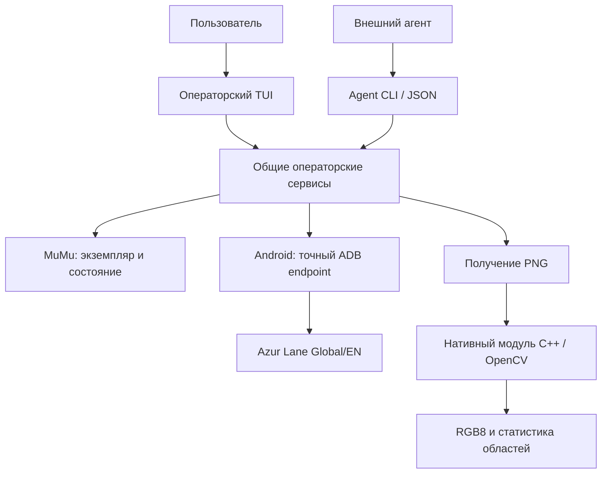

<div align="center">

# AzurPilotRu — управление MuMu и Azur Lane из Windows

**Приложение для управления окружением Azur Lane: интерактивный терминал, команды для агентов и проверяемая диагностика.**

[](https://github.com/AliceLiddell01/AzurPilotRu/actions/workflows/ci.yml)


[](LICENSE)

**Windows x64 · .NET / C# · C++ / OpenCV · MuMuPlayer · Android / ADB**

AzurPilotRu объединяет управление конкретным экземпляром MuMu, проверку готовности Android и запуск Azur Lane Global/EN. Доступны операторский интерфейс в терминале, машинный JSON-интерфейс и диагностика изображений через нативный модуль. Все пользовательские объяснения и документация проекта — на русском языке.

**Это развивающийся проект, а не готовый бот для прохождения Azur Lane.** Автоматизация игрового UI, ввод, OCR и распознавание через ONNX пока не реализованы.

[Возможности](#возможности) · [Как устроен](#как-это-устроено) · [Быстрый старт](#быстрый-старт) · [Управление](#управление) · [Архитектура](#архитектура) · [Проверки](#проверки) · [Документация](#документация)

</div>

---

## Для кого этот проект

- **Пользователям MuMu и Azur Lane**, которым нужна единая точка управления эмулятором, Android-окружением и состоянием игры.
- **Разработчикам Windows-автоматизации**, которым интересны явный выбор целевого экземпляра, диагностические свидетельства и взаимодействие .NET с C++/OpenCV.
- **Разработчикам ИИ-агентов**, которым нужен отдельный машинный интерфейс с описанием доступных операций, структурированными результатами и контролируемыми изменениями состояния.

## Зачем нужен AzurPilotRu

Управление эмулятором и игрой состоит из нескольких разных задач: найти нужный экземпляр MuMu, установить его состояние, разрешить точное Android-подключение, проверить готовность системы и лишь затем выполнять действия с игрой. Нельзя надёжно заменить эту последовательность догадками о портах, первым найденным устройством или фиксированными задержками.

> **Каждое действие должно относиться к определённому экземпляру, а его результат — подтверждаться наблюдаемым состоянием.**

Поэтому AzurPilotRu разделяет наблюдение, подготовку окружения и действия, изменяющие состояние. Терминал и машинный интерфейс используют общие прикладные операции вместо двух независимых реализаций управления.

## Возможности

| Возможность | Что реализовано |
| --- | --- |
| **Операторский TUI** | Интерактивная оболочка на Terminal.Gui: состояние окружения, запуск и остановка, настройки, помощь и режимы доступа к техническим операциям. |
| **Управление MuMu** | Обнаружение установки и экземпляров поддерживаемого семейства MuMu 6, выбор точного экземпляра, запуск, остановка и перезапуск с проверкой результата. |
| **Android / ADB** | Работа с поставляемым ADB, разрешение адреса выбранного экземпляра, проверка транспорта, shell и завершения загрузки Android. |
| **Жизненный цикл игры** | Наблюдение за установкой, процессом и передним планом Azur Lane Global/EN; запуск и остановка через общий сервис управления. |
| **Agent CLI** | Команды `agent` с обнаружением поддерживаемых операций, JSON-ответами, типизированными отказами и явной адресацией целевого экземпляра. |
| **Диагностика скриншотов** | Получение PNG через Android, декодирование в нативный RGB8-кадр и анализ именованных областей `FullFrame` и `Center` средствами OpenCV. |
| **Конфигурация и журнал** | Строгая конфигурация, сохранение настроек из TUI, структурированные журналы и отдельное окно просмотра журнала. |
| **Инструменты проверки** | Native/managed тесты, отдельные средства приёмки на реальной MuMu и инструмент визуальной проверки TUI через ConPTY и браузерный терминал. |

Точный набор команд и ограничения каждого режима: [операторский TUI](docs/architecture/operator-tui.md) и [Agent CLI](docs/reference/agent-cli.md).

## Как это устроено



**Наблюдение не равно управлению.** Обычная диагностика не запускает MuMu, не подключает ADB и не запускает игру. Операции, изменяющие состояние, требуют однозначно установленной цели; в TUI для них предусмотрено подтверждение. Диагностика пикселей не выдаётся за распознавание интерфейса игры.

## Быстрый старт

Нужны **Windows x64**, .NET SDK из [`global.json`](global.json), **Visual Studio 2026** с компонентами разработки на C++ и **CMake** не ниже требования в [`native/CMakeLists.txt`](native/CMakeLists.txt). Git и необходимые средства сборки должны быть доступны в `PATH`. При первой сборке потребуется сеть для получения OpenCV; версия и контрольная сумма закреплены в [`native/opencv.json`](native/opencv.json).

Откройте **PowerShell**:

```powershell
git clone https://github.com/AliceLiddell01/AzurPilotRu.git
cd AzurPilotRu

# Нативная библиотека и её тесты
Push-Location native
cmake --workflow --preset native-x64-release
Pop-Location

# .NET: зависимости, сборка, проверки
dotnet restore AzurPilot.slnx --locked-mode
dotnet build AzurPilot.slnx --configuration Release --no-restore -warnaserror
dotnet test tests/AzurPilot.Tests/AzurPilot.Tests.csproj --configuration Release --no-restore --no-build

# Запуск интерактивного приложения
dotnet run --project src/AzurPilot.App --configuration Release --no-build
```

В подключённом терминале запускается TUI. При перенаправленных потоках приложение вместо него выполняет однократную диагностику. Отсутствие пользовательской конфигурации допустимо; её неверный формат вызывает явный отказ, а не молчаливый сброс.

[Полная инструкция по сборке, запуску и устранению ошибок →](docs/getting-started.md)

## Управление

### Операторский терминал

Основные действия доступны через палитру команд. **«Запустить окружение»** подготавливает выбранный MuMu и Android, не запуская игру. **«Запустить игру»** при необходимости сначала подготавливает окружение. Для остановки предусмотрены отдельные действия.

Режимы интерфейса:

| Режим | Для чего |
| --- | --- |
| `normal` | Основные пользовательские операции, состояние, настройки. |
| `manual` | Дополнительно — ручные действия с MuMu, Android и игрой. |
| `diagnostic` | Дополнительно — подробная диагностика, скриншоты и технические сведения. |

Режим можно выбрать при запуске:

```powershell
dotnet run --project src/AzurPilot.App -c Release --no-build -- --mode diagnostic
```

Подробнее: [действия и режимы TUI →](docs/architecture/operator-tui.md).

### Команды для внешних агентов

Agent CLI не требует запуска интерактивного терминала. Его контракт можно получить из самого приложения:

```powershell
dotnet run --project src/AzurPilot.App -c Release --no-build -- agent discover
dotnet run --project src/AzurPilot.App -c Release --no-build -- agent status
dotnet run --project src/AzurPilot.App -c Release --no-build -- agent instances
```

Ответ — один JSON-документ в `stdout`; диагностические сообщения направляются отдельно в `stderr`. Поддерживаемые команды, аргументы и признак изменения состояния публикуются через `discover`. Операции над конкретным Android-экземпляром требуют корректно разрешённой цели.

[Справочник Agent CLI и формат результатов →](docs/reference/agent-cli.md)

## Архитектура

Проект состоит из **трёх .NET-компонентов приложения** и отдельной **нативной библиотеки**:

| Компонент | Ответственность |
| --- | --- |
| [`AzurPilot.Core`](src/AzurPilot.Core) | Контракты и прикладная логика; координация операций MuMu, Android и игры без привязки к Windows. |
| [`AzurPilot.Windows`](src/AzurPilot.Windows) | Windows-адаптеры, MuMu, ADB и взаимодействие с нативной библиотекой. |
| [`AzurPilot.App`](src/AzurPilot.App) | Точка входа, состав приложения, TUI, Agent CLI, журнал и диагностика. |
| [`native/`](native/) | CMake, C++20, OpenCV и версионируемый C ABI для нативных операций. |

Связь .NET и C++ проходит через ограниченный версионируемый C ABI; код интерфейса не обращается напрямую к ADB для управления состоянием.

[Подробная схема архитектуры и границы компонентов →](docs/architecture/overview.md)

## Проверки

| Уровень | Что проверяется |
| --- | --- |
| **CMake / CTest** | Сборка нативной библиотеки и поведение ABI. |
| **Тесты .NET** | Межъязыковое взаимодействие, конфигурация, сценарии отказа, управление окружением и контракты репозитория. |
| **Windows CI** | Стандартные сборка и автоматические проверки в Windows. |
| **Локальная приёмка** | Поведение на реальном MuMu/ADB/Azur Lane и проверка получения изображений; не заменяется имитациями в CI. |
| **TUI Harness** | Запуск настоящего приложения через ConPTY, воспроизведение терминального вывода и визуальные проверки. |

CI проверяет код и контролируемые сценарии, но **не подтверждает работу на конкретной установленной у пользователя MuMu или игре** — для этого предусмотрены отдельные процедуры приёмки.

[Что именно доказывают проверки →](docs/testing/verification.md) · [Проверка TUI →](docs/testing/tui-harness.md)

## Документация

- [Начало работы](docs/getting-started.md) — требования, сборка, запуск и диагностика ошибок.
- [Операторский TUI](docs/architecture/operator-tui.md) — интерфейс, действия, режимы и подтверждения.
- [Agent CLI](docs/reference/agent-cli.md) — доступные операции, JSON-контракт и ограничения.
- [MuMu](docs/architecture/mumu-lifecycle.md) — выбор экземпляра и жизненный цикл.
- [Android и игра](docs/architecture/android-game-lifecycle.md) — ADB, готовность устройства и Azur Lane.
- [Скриншоты](docs/architecture/screenshot-diagnostics.md) — PNG, нативный кадр и анализ областей.
- [Карта всей документации](docs/README.md) — дополнительные руководства и материалы для разработки.

## Лицензия

Исходный код распространяется по лицензии **GNU AGPL-3.0**. Условия — в файле [LICENSE](LICENSE).

---

<div align="center">

**AzurPilotRu: сначала точная цель и проверяемое состояние, затем управление окружением и игрой.**

</div>
